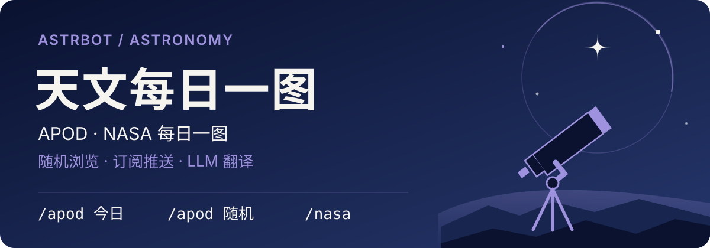

# 天文每日一图

  

AstrBot 插件，支持查看和订阅天文图片、视频及说明，并可用 LLM 翻译标题和正文。

- **天文每日一图（APOD）**提供最新一期、随机历史条目和订阅推送。最新一期来自 NASA 官方 APOD RSS，读取失败时回退到官方文章 feed。随机条目来自官网 Random APOD 接口。
- **NASA 每日一图（Image of the Day）**读取 NASA 官网的最新图片与说明，可用 `/nasa` 查看。

## 快速开始

需要 AstrBot 4.28.2 或更新版本。插件元数据声明支持 `aiocqhttp`。

1. 从本仓库安装并启用插件。
2. 在聊天中发送 `/apod 今日`，查看最新一期 APOD。
3. 如需自动推送，在插件配置中确认「启用推送」已打开，再到目标会话发送 `/apod管理 订阅`。

## 指令

| 指令 | 说明 |
| --- | --- |
| `/apod` | 查看帮助 |
| `/apod 今日` | 查看最新一期 APOD |
| `/apod 随机` | 随机查看一期历史 APOD |
| `/nasa` | 查看 NASA 每日一图 |
| `/apod管理` | 查看订阅管理帮助 |
| `/apod管理 订阅` | 为当前会话订阅 APOD 推送 |
| `/apod管理 退订` | 取消当前会话的订阅 |
| `/apod管理 清理` | 清理翻译、内容和图片缓存，保留推送记录 |

群聊中，`/apod管理` 默认仅管理员可用。可在 AstrBot WebUI 的「指令管理」调整权限。

## 订阅与补发

订阅指令会同步更新插件配置中的「推送/订阅名单 (UMO)」。APOD 支持两种推送模式。

| 模式 | 触发方式 |
| --- | --- |
| 定时推送（默认） | 每天按服务器本地时间检查并推送，默认 `01:00` |
| 上游更新 | 按间隔检查官方 feed，默认每 30 分钟一次。首次检查建立基准，后续发现新一期时推送 |

- **确认未提交**。正文与媒体分别记录进度，后续只补缺失的部分。图片预下载失败时先发正文。若本轮只剩图片待补且预下载成功，会按 `retry_count` 在同轮内退避补图。定时推送未完成时，6 分钟后补试一次。
- **发送结果未知**。超时、连接失败或提交后断连时，该部分不自动重发。日志和推送汇总会单独标记，按未确认统计。若适配器跳过发送却返回成功，插件会记为已送达，实际结果以会话中的消息为准。
- **换刊或关闭媒体**。换刊后放弃上一期未补完的内容并记录日志。关闭「发送媒体」后跳过待补媒体。

## 翻译与 LLM 工具

翻译提供商留空时使用 AstrBot 为当前会话选择的对话模型。标题、说明和随说明显示的「明日一图」可合并到一次翻译请求，未译字段保留原文。

启用 AstrBot 的函数调用后，模型可使用以下工具向当前会话发送内容。

| 工具 | 内容 |
| --- | --- |
| `send_apod_today` | 最新一期 APOD |
| `send_apod_random` | 随机历史 APOD |
| `send_nasa_today` | NASA 每日一图 |

## 媒体与回复设置

- 图片按 `is_divided` 设置与正文合并或分开发送。直链视频始终单独发送。YouTube 条目显示观看链接，有可用封面时按图片处理。
- 图片下载跟随 AstrBot 的 `http_proxy` 设置并校验证书。可重试的失败按 `retry_count` 重试，默认 3 次，间隔从 1、2、4 秒起并加入抖动。关闭图片缓存后，推送仍会先下载到临时文件，发送结束后清理。不可读的缓存文件会作废，同一次推送检查中所有会话共享一次坏文件重下的机会。
- `quote_reply` 默认关闭。开启后，引用只附在指令回复首条成功发送的消息上。内容指令直接发送，跳过全局 At、引用、文字转图、回复前缀、TTS、内容安全与回复装饰钩子。帮助和订阅管理沿用框架回复流程。

## 来源与许可证

本项目修改自 [Cysheper 的 APOD 插件](https://github.com/Cysheper/astrbot_plugin_Astronomy_Picture_of_the_Day-APOD)，按 [AGPL-3.0](./LICENSE) 发布。
